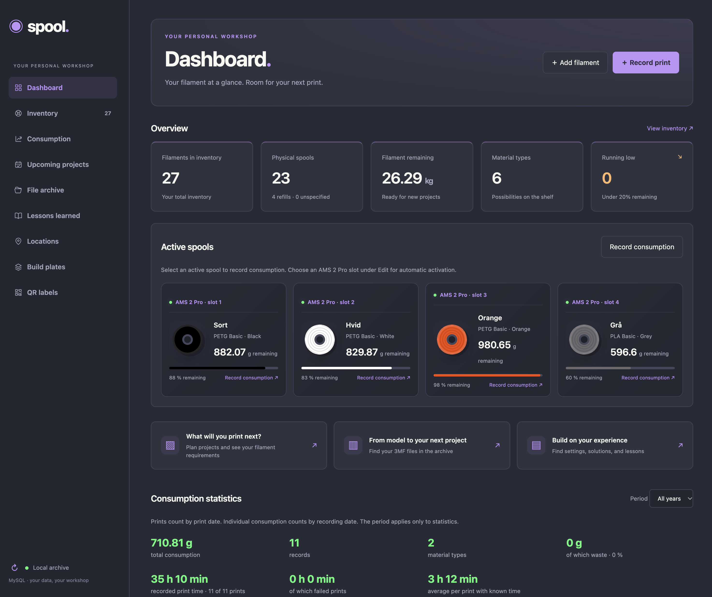

# Filament DB

A web application for managing filament inventory, prints, and lessons learned, with a Dracula theme and JSON-based interface translations. Data is stored on the server and shared across your devices.



## Quick start

Requires Python 3.11 or later. Run from the project root:

```sh
python3 -m src.app
```

Open http://127.0.0.1:49173. The SQLite database is created automatically at `data/filaments.sqlite3`, with an empty inventory. Local SQLite operation needs no external Python packages. The frontend uses JavaScript ES modules without a build step or CDN.

See [Getting started](docs/getting-started.md) for configuration and browser app installation. Production uses Docker and MySQL 8.4; see [Deployment](docs/deployment.md) and [MySQL](docs/mysql.md).

## User guides

| Topic | Contents |
|---|---|
| [Inventory and locations](docs/inventory-and-locations.md) | Spools, [material type administration](docs/inventory-and-locations.md#material-type-administration), AMS, QR labels, [M220 thermal labels](docs/inventory-and-locations.md#phomemo-m220-labels), and archiving |
| [Manufacturer material profiles](docs/material-profiles.md) | Bambu guide lookup, source provenance, and label defaults |
| [Native M220 printing](docs/native-printing.md) | Editable Phomymo-compatible designs, USB/Bluetooth, monochrome preview, JSON/PNG export, and physical verification |
| [Label templates and variables](docs/label-templates.md) | Design shared templates visually, use spool variables, and import/export size-specific JSON |
| [Prints and consumption](docs/prints-and-consumption.md) | Print records, individual consumption, waste, history, and statistics |
| [Projects and shopping](docs/projects-and-shopping.md) | 3MF projects, build plates, filament requirements, and shopping lists |
| [File archive](docs/file-archive.md) | Uploads, estimates, images, and print history per file |
| [Lessons learned](docs/lessons-learned.md) | Articles, categories, tags, and print sources |
| [AI suggestions](docs/ai-suggestions.md) | OpenAI configuration and approval of suggestions from print notes |

## Operations

| Topic | Contents |
|---|---|
| [Deployment and updates](docs/deployment.md) | Docker, nginx, versioning, and container names |
| [Nginx reverse proxy](docs/deployment.md#nginx-reverse-proxy-example) | HTTPS configuration example for existing host nginx |
| [MySQL in production](docs/mysql.md) | Connections, environment files, and required database privileges |
| [Backup and restore](docs/backup.md) | Combined backups of the database and original 3MF files |

Administration stays at the bottom of the navigation and groups browser-local language settings with shared material type, build plate, and lessons category management. It also shows the running app version, configured SQLite/MySQL backend, a database-readability indicator with the duration of a fixed SELECT query.

The app has no login. The default setup publishes port **49173** on localhost only; an existing nginx handles HTTPS and any access control. CSV exports inventory; a complete backup must include both the database and file archive.

## Development

| Topic | Contents |
|---|---|
| [Architecture](docs/architecture.md) | Python modules, ES modules, state, and transactions |
| [Development and testing](docs/development.md) | Syntax checks, frontend tests, Python tests, and Ruff |
| [GitHub repository settings](docs/repository-settings.md) | Access, pull requests, CI, security, and public releases |
| [Language files](docs/localization.md) | Administration language selection, adding languages, translation keys, and fallback behavior |

[AGENTS.md](AGENTS.md) defines repository rules for agents. All project documentation is maintained in English. Run documentation commands from the project root. User guide action names are described in English; displayed labels depend on the selected interface language.

## Contributing and security

See [Contributing](CONTRIBUTING.md) for pull requests and development checks,
and [Security policy](SECURITY.md) for private vulnerability reporting.

## License

Copyright (c) 2026 Kasper Thunø, creator of Filament DB.

Except for third-party components identified under their own licenses,
Filament DB is licensed under the [GNU Affero General Public License,
version 3 only (AGPL-3.0-only)](LICENSE).

Commercial use, sale, and paid hosting are permitted under the license.
Redistribution of covered works requires preserving the copyright and license
notices and providing the corresponding source code as required by the AGPL.
Modified covered works must remain under the AGPL when distributed. If you
modify the program and let users interact with it remotely over a computer
network, you must prominently offer those users access to the corresponding
source code of that version at no charge, as required by section 13.
These obligations limit proprietary derivatives; they do not prohibit
commercial use. See LICENSE for the full terms and warranty disclaimer.

Third-party components retain their own licenses. In particular,
[the bundled QR code generator](static/vendor/qrcodegen.js) by Project Nayuki
remains MIT-licensed; its license notice must be preserved.
